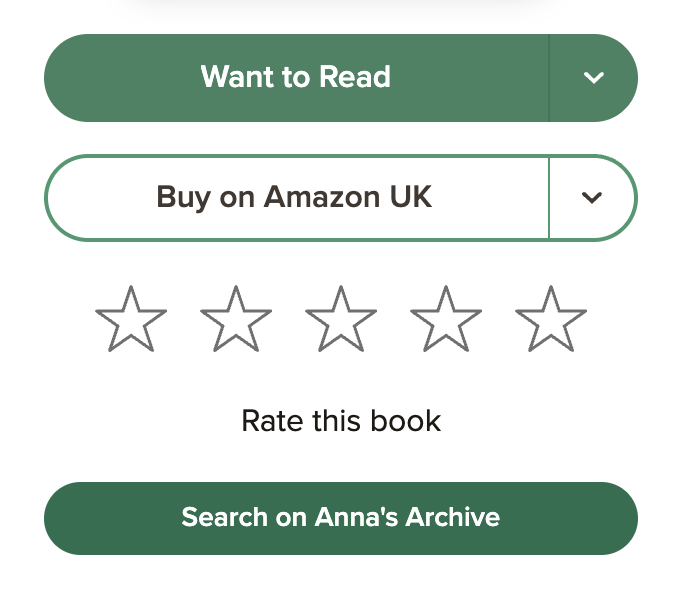

# Goodreads → Anna's Archive Search

a Tampermonkey userscript that adds a **Search on Anna's Archive** button to Goodreads book pages. click to open an Anna's Archive search for that book's title and author in a new tab.

## changing the website address
anna's archive often moves to a new web address after a domain is taken down. the script uses `annas-archive.gl` by default. If the button opens a page that doesn't load, change the address using the tampermonkey menu on a Goodreads page, or edit the `DEFAULT_DOMAIN` through the script directly.
